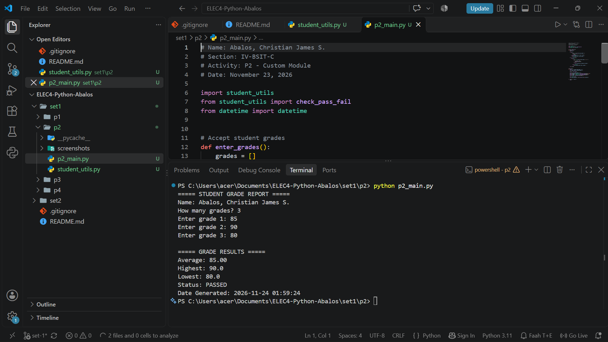
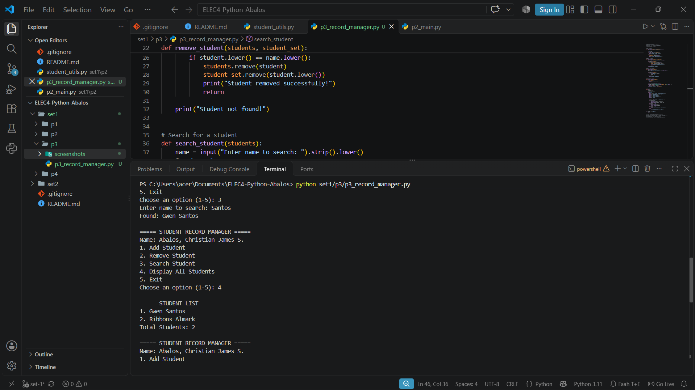
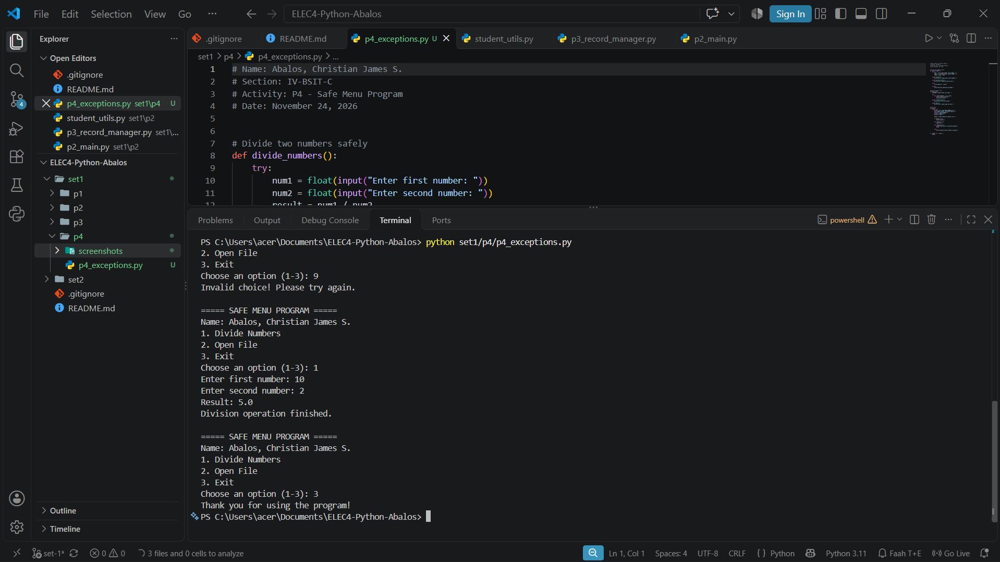

# ELEC 4 - Python Programming

**Name:** Abalos, Christian James S.  
**Section:** IV-BSIT-C  
**Course:** ELEC 4 - Python Programming

## Set 1 Activities

### P1 - Student Grade Calculator
A menu-driven program that calculates the average,
highest, lowest, and pass/fail status of grades.

Run:
`python set1/p1/p1_grade_calculator.py`

[View P1 Folder](set1/p1)

### P2 - Custom Module: student_utils
Uses custom and built-in Python modules to calculate
student grades and display a report with date and time.

Run:
`python set1/p2/p2_main.py`

[View P2 Folder](set1/p2)

### P3 - Student Record Manager
Manages student names using lists and sets.

Run:
`python set1/p3/p3_record_manager.py`

[View P3 Folder](set1/p3)

[Add Students](set1/p3/screenshots/p3_add_students.png) |
[Duplicate Prevention](set1/p3/screenshots/p3_duplicate.png) |
[Search Student](set1/p3/screenshots/p3_search.png) |
[Remove Student](set1/p3/screenshots/p3_remove_display.png)

### P4 - Safe Menu Program
Handles invalid inputs using exception handling.

Run:
`python set1/p4/p4_exceptions.py`

[View P4 Folder](set1/p4)

[Division Errors](set1/p4/screenshots/p4_division_errors.png) |
[Missing File](set1/p4/screenshots/p4_missing_file.png) |
[Invalid Menu](set1/p4/screenshots/p4_invalid_menu.png)