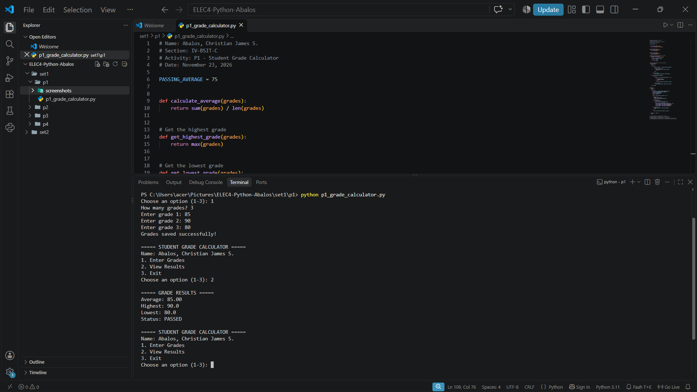

# ELEC 4 - Python Programming

**Name:** Abalos, Christian James S.  
**Section:** IV-BSIT-C  
**Course:** ELEC 4 - Python Programming

## Set 1 Activities

### P1 - Student Grade Calculator
A menu-driven program that calculates the average,
highest, lowest, and pass/fail status of grades.

Run:
`python set1/p1/p1_grade_calculator.py`

[View P1 Folder](set1/p1)

### P2 - Custom Module: student_utils
Uses custom and built-in Python modules.

[View P2 Folder](set1/p2)

### P3 - Student Record Manager
Manages student names using lists and sets.

[View P3 Folder](set1/p3)

### P4 - Safe Menu Program
Handles invalid inputs using exception handling.

[View P4 Folder](set1/p4)
